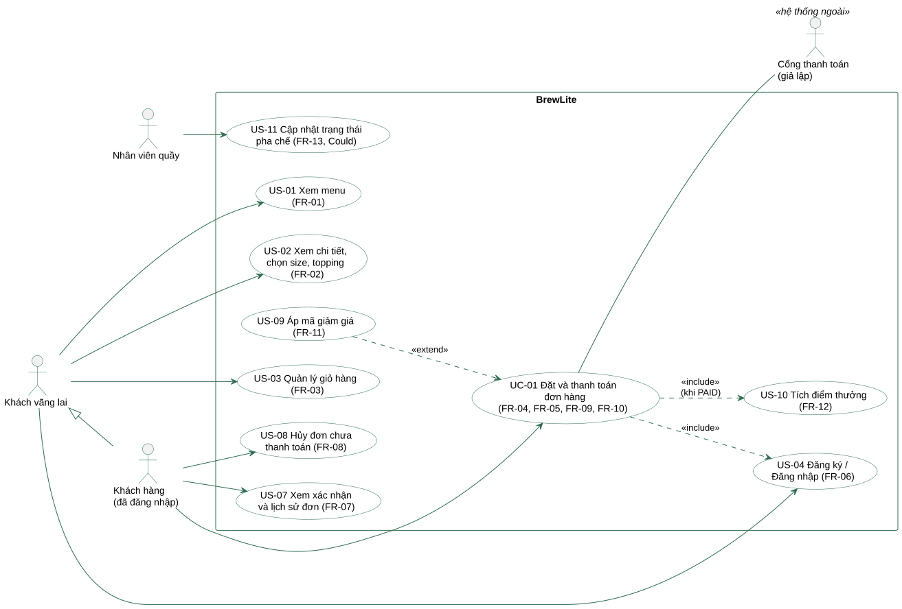

# BrewLite – Đặc tả yêu cầu phần mềm rút gọn (SRS, Task 1.2)

> Người soạn: TV2 – Lê Hữu Nhân (Product Owner). Phiên bản 1.0.
> Đọc trước: [Bối cảnh và phạm vi](context-and-scope.md). Use-case trọng tâm: [UC-01](uc-01-dat-va-thanh-toan.md).

## 1. Mục đích và quy ước

Tài liệu liệt kê **hệ thống phải làm gì** (yêu cầu chức năng, mã `FR-xx`) và **phải đạt chất lượng nào** (yêu cầu phi chức năng, mã `NFR-xx`). Mỗi yêu cầu có:

- **Ưu tiên MoSCoW:** Must (bắt buộc cho MVP), Should (nên có), Could (có thì tốt), Won't (không làm trong bản này).
- **Tiêu chí chấp nhận:** câu kiểm chứng được, dùng trực tiếp để viết test. Mã test dự kiến ghi ở cột cuối, đầy đủ trong [ma trận truy vết](../traceability-matrix.md).

Quy ước mã test: `UNIT-Txx` unit test, `UI-Txx` test component web, `API-Txx` test API đọc dữ liệu, `INT-Txx` integration test với CSDL thật, `E2E-Txx` test end-to-end trên trình duyệt.

## 2. Actor

| Actor | Mô tả |
|---|---|
| Khách vãng lai | Chưa đăng nhập: xem menu, chi tiết món, thêm vào giỏ |
| Khách hàng | Đã đăng nhập: đặt đơn, thanh toán, xem lịch sử, nhận điểm thưởng |
| Nhân viên quầy | Pha chế; cập nhật trạng thái đơn (FR-13, Could) |
| Cổng thanh toán (giả lập) | Hệ thống ngoài, trả kết quả thanh toán thành công / thất bại |

## 3. Sơ đồ use-case tổng quát

Nguồn: [`usecase-overview.puml`](usecase-overview.puml). Use-case chi tiết của luồng đặt và thanh toán: [`usecase-checkout.svg`](usecase-checkout.svg).

| Use-case / User story | Actor | Yêu cầu |
|---|---|---|
| US-01 Xem menu | Khách vãng lai, Khách hàng | FR-01 |
| US-02 Xem chi tiết, chọn size và topping | Khách vãng lai, Khách hàng | FR-02 |
| US-03 Quản lý giỏ hàng | Khách vãng lai, Khách hàng | FR-03 |
| US-04 Đăng ký, đăng nhập | Khách vãng lai | FR-06 |
| **UC-01 Đặt và thanh toán đơn hàng** (gồm US-05 Đặt đơn, US-06 Thanh toán) | Khách hàng, Cổng thanh toán | FR-04, FR-05, FR-09, FR-10 |
| US-07 Xem xác nhận và lịch sử đơn | Khách hàng | FR-07 |
| US-08 Hủy đơn chưa thanh toán | Khách hàng | FR-08 |
| US-09 Áp mã giảm giá | Khách hàng | FR-11 |
| US-10 Tích điểm thưởng | Khách hàng | FR-12 |
| US-11 Cập nhật trạng thái pha chế | Nhân viên quầy | FR-13 |

## 4. Yêu cầu chức năng

| Mã | Tên | Mô tả | Ưu tiên | Tiêu chí chấp nhận | Test |
|---|---|---|---|---|---|
| FR-01 | Xem menu | Hiển thị danh sách đồ uống gồm tên, mô tả, ảnh, giá (VND) | Must | (1) `GET /products` trả 200 và mảng món có `id, name, price, imageUrl`. (2) Màn menu có trạng thái **đang tải** (khung chờ), **rỗng** ("Chưa có món nào trong menu."), **lỗi** (thông báo + nút "Thử lại"). (3) Điện thoại 1 cột, laptop 4 cột. | API-T01, UI-T01 → UI-T04 |
| FR-02 | Chi tiết món và tùy chọn | Xem chi tiết 1 món, chọn size S/M/L (phụ thu 0 / 5.000 / 10.000đ), chọn topping, số lượng | Must | (1) `GET /products/:id` trả món kèm `sizes`, `toppings`. (2) id không tồn tại → 404; id không phải số → 400. (3) Đổi size/topping thì giá hiển thị cập nhật ngay. | API-T02, UNIT-T02, UNIT-T03 |
| FR-03 | Giỏ hàng | Thêm, sửa số lượng, xóa món; giỏ lưu trên trình duyệt | Must | (1) Cùng món + size + topping thì gộp 1 dòng. (2) Mỗi dòng 1–20 ly; đặt về 0 thì bỏ món. (3) Tổng tiền = Σ đơn giá × số lượng. (4) Tải lại trang giỏ vẫn còn. | UNIT-T04 → UNIT-T07 |
| FR-04 | Đặt đơn | Gửi giỏ hàng lên server, tạo đơn trạng thái PENDING | Must | (1) `POST /orders` cần JWT, trả 201 và mã đơn. (2) Server **tự tính lại** giá từ CSDL, bỏ qua giá client gửi. (3) Dữ liệu sai (size lạ, số lượng 0 hoặc > 20, giỏ rỗng) → 400. | INT-T04 |
| FR-05 | Thanh toán | Trả tiền đơn bằng Ví điện tử hoặc Thẻ qua cổng giả lập | Must | (1) `POST /payments` thành công → đơn chuyển PAID, giao dịch SUCCESS. (2) Cổng từ chối → đơn PAYMENT_FAILED, cho thử lại. (3) Chỉ trả được đơn của mình (đơn người khác → 404). (4) Không có phương thức tiền mặt. | INT-T03, UNIT-T16 |
| FR-06 | Đăng ký, đăng nhập | Tài khoản email + mật khẩu, phiên đăng nhập bằng JWT | Must | (1) Đăng ký email trùng → 409; mật khẩu < 8 ký tự → 400. (2) Đăng nhập đúng → `accessToken`; sai → 401. (3) API cần đăng nhập mà thiếu/sai token → 401. (4) Mật khẩu lưu dạng băm bcrypt. | INT-T02 |
| FR-07 | Xác nhận và lịch sử đơn | Màn xác nhận sau khi trả tiền; danh sách đơn của tôi | Must | (1) Trả tiền xong chuyển tới `/orders/:id`, thấy "Đặt hàng thành công" và tiến trình "Đã trả tiền". (2) `GET /orders/me` chỉ trả đơn của người đang đăng nhập, mới nhất trước. | E2E-T01, INT-T04 |
| FR-08 | Quản lý trạng thái đơn | Máy trạng thái đơn, khách hủy đơn chưa trả tiền | Must | (1) Chỉ cho phép chuyển: PENDING → PAID / PAYMENT_FAILED / CANCELLED; PAYMENT_FAILED → PENDING / CANCELLED; PAID → PREPARING / CANCELLED; PREPARING → READY → COMPLETED. (2) Chuyển sai → 400 kèm lý do. (3) Khách chỉ tự hủy đơn PENDING / PAYMENT_FAILED; hủy thì trả lại tồn kho. | UNIT-T15, INT-T04 |
| FR-09 | Không bán quá tồn kho | Trừ kho khi tạo đơn, an toàn khi nhiều người đặt cùng lúc | Must | (1) Đặt quá số còn → 400 ("… chỉ còn n ly"), không tạo đơn. (2) N khách đặt đồng thời món còn ít: tổng bán ra ≤ tồn kho, tồn kho không âm. | INT-T04, INT-T05 |
| FR-10 | Chống thanh toán trùng | Header `Idempotency-Key` bắt buộc cho `POST /payments` | Must | (1) Gửi 2 lần cùng key → cùng 1 giao dịch, chỉ trừ tiền 1 lần. (2) Thiếu key → 400. | INT-T03, UNIT-T16 |
| FR-11 | Mã giảm giá | Nhập mã ở bước thanh toán, giảm theo %, có mức tối đa | Should | (1) `GET /coupons/:code/validate?subtotal=` trả số tiền giảm. (2) Mã không tồn tại → 404; hết hạn, hết lượt, chưa đạt giá trị tối thiểu → 400. (3) Không phân biệt hoa/thường. | UNIT-T08 → UNIT-T11 |
| FR-12 | Điểm thưởng | Cộng điểm khi đơn được thanh toán | Should | (1) 10.000đ = 1 điểm, tính trên tổng sau giảm giá. (2) Mỗi đơn cộng 1 lần, ghi 1 dòng `LoyaltyTransaction` loại EARN. (3) `GET /loyalty/me` trả tổng điểm và lịch sử. | UNIT-T12 → UNIT-T14, INT-T02 |
| FR-13 | Nhân viên cập nhật trạng thái | Barista chuyển PAID → PREPARING → READY → COMPLETED | Could | Nhân viên đổi trạng thái thì màn xác nhận của khách hiện bước mới. *(Làm nếu Sprint 2 còn thời gian.)* | – |
| FR-14 | Thanh toán tiền mặt, giao hàng | – | Won't | Không làm trong dự án (xem out-of-scope). | – |

## 5. Yêu cầu phi chức năng

| Mã | Nhóm | Yêu cầu | Ưu tiên | Tiêu chí chấp nhận | Kiểm chứng |
|---|---|---|---|---|---|
| NFR-01 | Hiệu năng | API phản hồi nhanh để thanh toán một chạm | Must | Mỗi API trong luồng (menu, tạo đơn, thanh toán) phản hồi **< 500 ms** khi chạy local, không tính thời gian giả lập cổng thanh toán (300 ms). Trang menu hiển thị nội dung trong < 3 giây trên 4G. | Log thời gian mỗi request (`GET /products 200 12ms`), Postman |
| NFR-02 | Bảo mật | Bảo vệ tài khoản, tiền và dữ liệu | Must | (1) Mật khẩu băm bcrypt. (2) JWT hết hạn sau 1 giờ. (3) Khách chỉ xem/trả đơn của mình. (4) Validate mọi dữ liệu vào, trường lạ → 400. (5) Secret không có trong repo, log không ghi token/mật khẩu. (6) CSDL production không public. | INT-T02 → INT-T04, review cấu hình deploy |
| NFR-03 | Tính dễ dùng (mobile-first/PWA) | Dùng thoải mái trên điện thoại | Must | (1) Giao diện đúng từ màn 360 px đến laptop. (2) Nút chính cố định ở đáy màn điện thoại. (3) Có Web App Manifest, thêm được vào màn hình chính. (4) Thông báo lỗi bằng tiếng Việt, nói rõ cách xử lý. | E2E-T01 chạy cả cấu hình điện thoại (Pixel 7) |
| NFR-04 | Khả năng triển khai | Chạy được ở mọi máy, deploy tự động | Must | (1) `docker compose up` chạy đủ web + API + CSDL. (2) CI chạy Install → Lint → Unit Test → Build trên mỗi PR, PR lỗi không merge được. (3) CD build image tag commit SHA, deploy, smoke test, có rollback. (4) Migration/seed tái tạo được CSDL. | Tab Actions, docs/deployment.md |
| NFR-05 | Toàn vẹn dữ liệu | Không mất, không lệch dữ liệu đơn và tiền | Must | (1) Tạo đơn + trừ kho trong 1 transaction. (2) Đổi trạng thái đơn + ghi giao dịch trong 1 transaction. (3) Optimistic locking cho tồn kho. | INT-T03 → INT-T05 |
| NFR-06 | Tính sẵn sàng | Hệ thống production truy cập được khi chấm | Must | (1) Frontend qua HTTPS. (2) `GET /health` trả `status: ok`, `db: up` và phiên bản đang chạy; CSDL lỗi → 503. (3) Container tự khởi động lại khi lỗi. | INT-T01, smoke test trong CD |

## 6. Danh sách API

| Phương thức | Đường dẫn | Cần JWT | Yêu cầu |
|---|---|---|---|
| GET | `/health` | Không | NFR-06 |
| GET | `/products` | Không | FR-01 |
| GET | `/products/:id` | Không | FR-02 |
| POST | `/auth/register`, `/auth/login` | Không | FR-06 |
| GET | `/auth/me` | Có | FR-06 |
| GET | `/coupons/:code/validate?subtotal=` | Không | FR-11 |
| POST | `/orders` | Có | FR-04, FR-09 |
| GET | `/orders/me`, `/orders/:id` | Có | FR-07 |
| PATCH | `/orders/:id/cancel` | Có | FR-08 |
| POST | `/payments` (header `Idempotency-Key`) | Có | FR-05, FR-10, FR-12 |
| GET | `/loyalty/me` | Có | FR-12 |

## 7. Quản lý thay đổi yêu cầu

Mọi thay đổi yêu cầu sửa trực tiếp file này qua Pull Request, ghi lý do trong mô tả PR và cập nhật [ma trận truy vết](../traceability-matrix.md) cùng lúc.

| Ngày | Phiên bản | Thay đổi | Người |
|---|---|---|---|
| 16/11/2026 | 1.0 | Bản đầu tiên cho Assignment 2 | TV2 |
