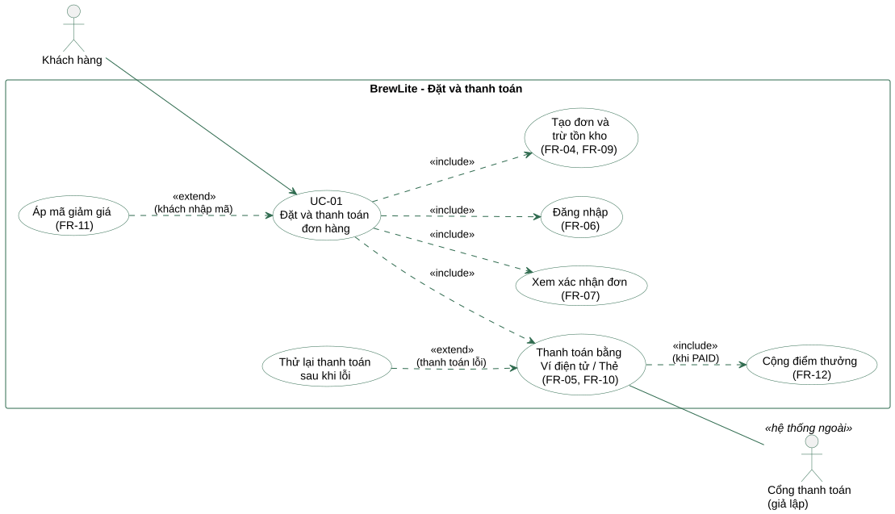

# UC-01 – Đặt và thanh toán đơn hàng

> Task 1.3 – Đặc tả use-case trọng tâm · Người viết: TV4 Phạm Thành Danh
> Mã yêu cầu tham chiếu theo `docs/requirements/srs.md`.

## 1. Sơ đồ use-case cho phạm vi này

File nguồn: [`docs/requirements/usecase-checkout.puml`](usecase-checkout.puml)

## 2. Thông tin chung

| Mục | Nội dung |
|---|---|
| **Mã / tên** | UC-01 – Đặt và thanh toán đơn hàng |
| **Actor chính** | Khách hàng (đã có tài khoản) |
| **Actor phụ** | Cổng thanh toán (giả lập Ví điện tử / Thẻ ngân hàng) |
| **Mục tiêu** | Khách trả tiền cho các món trong giỏ và nhận mã đơn để tới quầy lấy nước |
| **Trigger** | Khách bấm **"Thanh toán"** ở màn Giỏ hàng |
| **Mức ưu tiên** | Must (MoSCoW) |
| **Yêu cầu liên quan** | FR-03, FR-04, FR-05, FR-06, FR-07, FR-09, FR-10, FR-11, FR-12; NFR-01, NFR-02, NFR-05 |
| **Sơ đồ liên quan** | Activity-01 `activity-end-to-end`, Sequence-01 `sequence-checkout` |

## 3. Tiền điều kiện

1. Giỏ hàng có ít nhất 1 món, mỗi món tối đa 20 ly.
2. Các món trong giỏ đang được bán (còn trong CSDL).
3. Backend, CSDL và cổng thanh toán giả lập đang hoạt động.

## 4. Hậu điều kiện

**Khi thành công**
- Đơn ở trạng thái **PAID**, có một giao dịch **SUCCESS**. Số tiền giao dịch bằng tổng đơn do server tính.
- Tồn kho đã bị trừ đúng số ly của đơn.
- Nếu có mã giảm giá thì lượt dùng mã được ghi nhận. Khách được cộng điểm thưởng (1 điểm / 10.000đ).
- Giỏ hàng được xóa. Khách thấy màn **Xác nhận**: mã đơn, trạng thái, "Mời tới quầy lấy nước".

**Khi thất bại**
- Không có tiền bị trừ hai lần cho cùng một lần bấm (Idempotency-Key).
- Nếu thanh toán lỗi: đơn ở **PAYMENT_FAILED**, giỏ hàng **giữ nguyên**, khách thử lại được.
- Nếu không tạo được đơn (hết hàng, dữ liệu sai): không có đơn nào được lưu, tồn kho **không đổi**.

## 5. Luồng chính

| Bước | Khách hàng | Hệ thống |
|---|---|---|
| 1 | Bấm "Thanh toán" ở màn Giỏ hàng | |
| 2 | | Kiểm tra khách đã đăng nhập (JWT). Hiển thị màn Thanh toán: danh sách món, tạm tính, ô mã giảm giá, phương thức thanh toán |
| 3 | Chọn **Ví điện tử** hoặc **Thẻ ngân hàng** | Ghi nhận phương thức (không có tiền mặt) |
| 4 | Bấm **"Xác nhận trả"** | |
| 5 | | Validate dữ liệu; **tính lại giá** từ CSDL (giá gốc + size + topping), áp mã giảm giá nếu có |
| 6 | | Trong **một transaction**: trừ tồn kho từng món, lưu đơn trạng thái **PENDING** |
| 7 | | Gửi yêu cầu thanh toán kèm **Idempotency-Key** tới cổng giả lập; số tiền lấy từ tổng đơn, **không nhận từ client** |
| 8 | | Cổng trả kết quả **thành công** |
| 9 | | Trong một transaction: giao dịch → **SUCCESS**, đơn **PENDING → PAID**; ghi lượt dùng mã; cộng điểm thưởng |
| 10 | | Xóa giỏ hàng, chuyển sang màn **Xác nhận** |
| 11 | Xem mã đơn, tới quầy lấy nước | |

## 6. Luồng thay thế

| Mã | Tại bước | Điều kiện | Xử lý |
|---|---|---|---|
| A1 | 2 | Khách **chưa đăng nhập** hoặc token hết hạn | Chuyển sang màn Đăng nhập. Đăng nhập xong quay lại màn Thanh toán, giỏ hàng giữ nguyên. Quay lại bước 2 |
| A2 | 3 | Khách **nhập mã giảm giá** | Hệ thống kiểm tra mã (còn hạn, còn lượt, đơn đủ giá trị tối thiểu) rồi hiển thị số tiền giảm và tổng mới. Mã sai thì báo lỗi, tổng giữ nguyên, khách tiếp tục không dùng mã |
| A3 | 4 | Khách **bấm "Xác nhận trả" hai lần** hoặc mất mạng rồi bấm lại | Request gửi lại cùng Idempotency-Key. Hệ thống trả lại **đúng giao dịch cũ**, không tạo giao dịch mới, không trừ tiền lần hai |
| A4 | sau E3 | Khách **thử lại** sau khi thanh toán lỗi | Dùng lại đơn cũ (không tạo đơn mới): đơn **PAYMENT_FAILED → PENDING**, gửi thanh toán với key mới. Quay lại bước 7 |
| A5 | sau E3 | Khách **đổi mã giảm giá** rồi trả lại | Hủy đơn cũ (trả lại tồn kho), tạo đơn mới với giá mới. Quay lại bước 5 |

## 7. Luồng ngoại lệ

| Mã | Tại bước | Tình huống | Hệ thống phản hồi |
|---|---|---|---|
| E1 | 6 | **Hết hàng** / không đủ số ly | Báo `400 – "<Tên món> chỉ còn N ly"`. Hoàn tác transaction: không lưu đơn, tồn kho không đổi, giỏ giữ nguyên |
| E2 | 6 | Hai khách **chốt cùng lúc** món sắp hết (xung đột optimistic locking) | Người đến sau nhận `400 – "đang có người chốt đơn cùng lúc, vui lòng thử lại"`. Toàn bộ thay đổi được hoàn tác |
| E3 | 8 | **Cổng thanh toán từ chối** | Giao dịch **FAILED** (có lý do), đơn **PAYMENT_FAILED**. Màn Thanh toán báo lỗi và giữ giỏ. Khách có thể đi tiếp A4 |
| E4 | 5 | **Dữ liệu không hợp lệ**: size không có, số lượng > 20, client tự gửi giá hoặc số tiền, phương thức khác Ví/Thẻ | Báo `400` kèm lý do. Không tạo đơn, không gọi cổng thanh toán |
| E5 | 9 | Đơn **vừa bị hủy** hoặc đã được lượt khác trả xong trong lúc chờ cổng | Báo `409`. Giao dịch của lượt này **FAILED** (giả lập hoàn tiền), trạng thái đơn không bị ghi đè |
| E6 | 2, 5, 7 | Token **hết hạn / không hợp lệ** | Báo `401`. Frontend đăng xuất và chuyển sang Đăng nhập, giỏ giữ nguyên (đi tiếp A1) |
| E7 | 7 | Gửi thanh toán **thiếu Idempotency-Key** | Báo `400 – "Thiếu Idempotency-Key"` |

## 8. Quy tắc nghiệp vụ

| Mã | Quy tắc |
|---|---|
| BR-01 | Giá, giảm giá và tổng tiền **luôn do server tính** từ CSDL; client chỉ gửi mã món, size, topping, số lượng |
| BR-02 | Mỗi dòng trong giỏ tối đa **20 ly** |
| BR-03 | Chỉ thanh toán được đơn ở trạng thái **PENDING** (hoặc PAYMENT_FAILED khi thử lại), theo sơ đồ trạng thái của đề |
| BR-04 | Chỉ nhận **Ví điện tử (WALLET)** và **Thẻ (CARD)**; không dùng tiền mặt |
| BR-05 | Mỗi lượt bấm "Xác nhận trả" có một **Idempotency-Key** duy nhất; cùng key thì chỉ có một giao dịch |
| BR-06 | Tồn kho bị trừ lúc tạo đơn và **trả lại khi đơn bị hủy** |
| BR-07 | Khách chỉ tự hủy được đơn **chưa trả tiền** (PENDING, PAYMENT_FAILED) |
| BR-08 | Điểm thưởng: **1 điểm cho mỗi 10.000đ** của đơn PAID, mỗi đơn chỉ cộng một lần |

## 9. Yêu cầu phi chức năng áp dụng

- **NFR-01 Hiệu năng:** mỗi API trong luồng (tạo đơn, thanh toán) phản hồi dưới 500 ms, không tính thời gian giả lập cổng thanh toán.
- **NFR-02 Bảo mật:** mọi API của luồng yêu cầu JWT; khách chỉ thấy và trả tiền **đơn của chính mình** (đơn của người khác báo 404).
- **NFR-05 Toàn vẹn dữ liệu:** tạo đơn + trừ kho, và đổi trạng thái đơn + giao dịch, đều nằm trong transaction.

## 10. Truy vết

| Bước / luồng | Yêu cầu | API | Test |
|---|---|---|---|
| 2, A1, E6 | FR-06 | `POST /auth/login`, guard JWT | INT-T02; 401 trong INT-T03, INT-T04 |
| 5–6, E1, E2, E4 | FR-04, FR-09 | `POST /orders` | INT-T04 (trừ kho, đặt quá kho, dữ liệu sai), INT-T05 |
| A2 | FR-11 | `GET /coupons/:code/validate` | UNIT-T08 → UNIT-T11 |
| 7–9, A3, A4, E3, E5, E7 | FR-05, FR-10 | `POST /payments` | INT-T03 (trùng key, lỗi rồi thử lại, hủy giữa chừng), UNIT-T16 |
| 9 | FR-12 | (gọi trong `POST /payments`) | UNIT-T12 → UNIT-T14, INT-T03 |
| 10–11 | FR-07 | `GET /orders/:id` | E2E-T01 (menu → xác nhận) |
